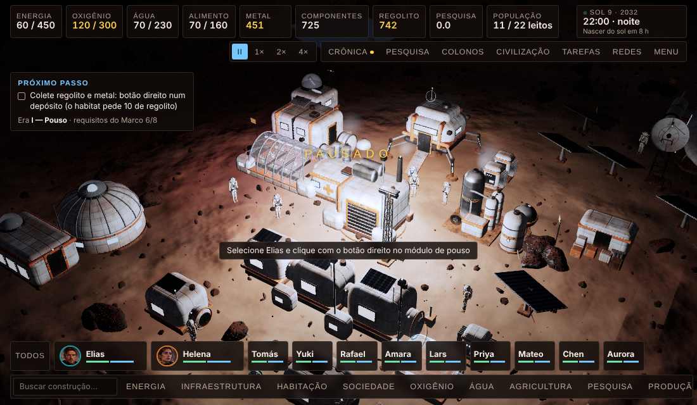

# Genesis Mars

Jogo de estratégia e colônia no navegador, inspirado em Age of Empires. É 2032: a SpaceZ levou Elias Ward e Helena Vasquez a Marte, e eles têm 7 sóis para preparar a base antes da chegada da Alvorada, com 12 colonos em criogenia. Depois vêm as casas, os bairros, o Berço, a Escola e uma sociedade nova.



## Jogar

Abra `index.html` num navegador moderno (Chrome, Edge ou Firefox). O jogo é um único arquivo e usa Three.js r128, carregado do cdnjs.

Para publicar no GitHub Pages: Settings → Pages → Branch `main`, pasta `/ (root)`.

## Estrutura

| Arquivo | O que faz |
|---|---|
| `src/data.js` | Dados do jogo: construções, colonos, eventos, textos, equilíbrio |
| `src/sim.js` | Simulação pura (roda no Node, sem gráficos) |
| `src/gfx.js` | Materiais e texturas procedurais, geometrias |
| `src/models.js` | Modelos 3D: construções, naves, astronautas |
| `src/render.js` | Cena, terreno carregado por regiões, luzes e efeitos |
| `src/ui.js` | Interface, cenas, áudio e controles |
| `src/page.html` | Layout e CSS |
| `src/art.js` | Retratos de Elias e Helena |
| `build.js` | Junta tudo em `genesis-mars.html` |
| `test.js` | Jogador automático que joga até a vitória |
| `t/view.js` | Tira capturas de tela com o Chrome sem janela (Playwright) |

## Comandos

```bash
node build.js        # gera genesis-mars.html (Three.js pelo CDN)
node build.js local  # gera local.html com o Three.js embutido (precisa de uma cópia local do three.js r128)
node test.js         # tem de terminar com "won true" e nenhuma morte
```

Depois de gerar, copie `genesis-mars.html` por cima de `index.html`.

## Controles

- Clique seleciona; arrastar seleciona vários; botão direito dá a ordem.
- W A S D ou as setas movem a câmera, Q e E giram, a roda do mouse dá o zoom.
- Espaço pausa; 1, 2 e 3 mudam a velocidade; C constrói outro igual ao prédio selecionado; N liga o modo Redes.

## Estado

Versão 5. O manual completo e o roteiro das próximas fases (Guarda, eras seguintes, versão em Unreal Engine 5) estão nos documentos do projeto.
