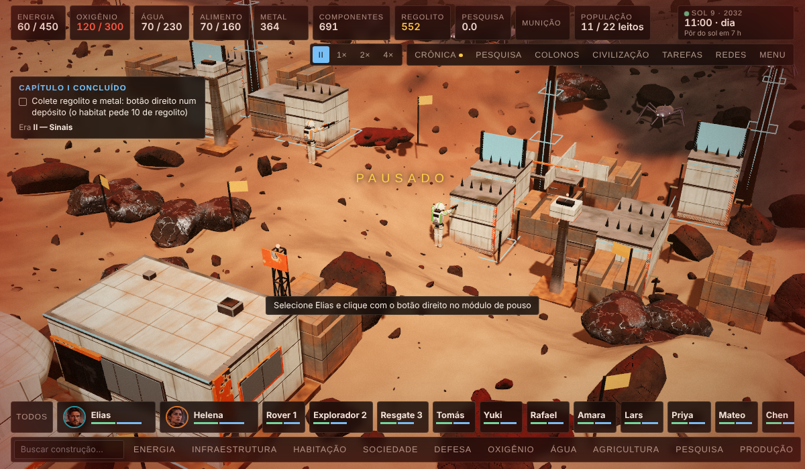

# Genesis Mars

Jogo de estratégia e colônia no navegador, inspirado em Age of Empires. É 2032: a SpaceZ levou Elias Ward e Helena Vasquez a Marte, e eles têm 7 sóis para preparar a base antes da chegada da Alvorada, com 12 colonos em criogenia. Depois vêm as casas, os bairros, o Berço, a Escola e uma sociedade nova.


## Instalar

O Genesis Mars é um app instalável (PWA). Com o GitHub Pages ligado, abra `https://damacinee-debug.github.io/genesismars/`:

- **Windows, Mac, Linux (Chrome ou Edge):** clique em **Instalar jogo** no menu do jogo, ou no ícone de instalar na barra de endereço. Ele ganha atalho na área de trabalho e abre em tela cheia, como um programa.
- **Android (Chrome):** menu ⋮ → **Instalar app**.
- **iPhone e iPad (Safari):** Compartilhar → **Adicionar à Tela de Início**.

Depois de instalado, o jogo abre mesmo sem internet. Para mandar uma atualização aos jogadores, mude a versão em `sw.js` (`genesis-mars-v7.1`) a cada publicação.

## Jogar

Abra `index.html` num navegador moderno (Chrome, Edge ou Firefox). O jogo é um único arquivo e usa Three.js r128, carregado do cdnjs.

Para publicar no GitHub Pages: Settings → Pages → Branch `main`, pasta `/ (root)`.

## Estrutura

| Arquivo | O que faz |
|---|---|
| `src/data.js` | Dados do jogo: construções, colonos, eventos, textos, equilíbrio |
| `src/sim.js` | Simulação pura (roda no Node, sem gráficos) |
| `src/gfx.js` | Materiais e texturas procedurais, geometrias |
| `src/models.js` | Modelos 3D: construções, naves, astronautas |
| `src/render.js` | Cena, terreno carregado por regiões, luzes e efeitos |
| `src/ui.js` | Interface, cenas, áudio e controles |
| `src/page.html` | Layout e CSS |
| `src/art.js` | Retratos de Elias e Helena |
| `build.js` | Junta tudo numa página (`pwa` gera o `index.html` instalável) |
| `src/pwa.html` | Registro do service worker e botão Instalar jogo |
| `manifest.webmanifest`, `sw.js`, `icons/` | Instalação e modo offline |
| `three.min.js` | Three.js r128 (MIT), servido junto para funcionar offline |
| `test.js` | Jogador automático que joga até a vitória |
| `t/view.js` | Tira capturas de tela com o Chrome sem janela (Playwright) |

## Comandos

```bash
node build.js pwa    # gera index.html instalável (é o que vai para o GitHub Pages)
node build.js        # gera genesis-mars.html (Three.js pelo CDN)
node build.js local  # gera local.html com o Three.js embutido (precisa de uma cópia local do three.js r128)
node test.js         # tem de terminar com "won true" e nenhuma morte
```


## Controles

- Clique seleciona; arrastar seleciona vários; botão direito dá a ordem.
- W A S D ou as setas movem a câmera, Q e E giram, a roda do mouse dá o zoom.
- Espaço pausa; 1, 2 e 3 mudam a velocidade; C constrói outro igual ao prédio selecionado; N liga o modo Redes.

## Era II — Sinais

Depois do Marco, a antena capta um sinal vindo do gelo ao norte. Começam os ataques noturnos, que crescem a cada noite. Defesa: Quartel (botão Armar no painel do colono), Arsenal (munição automática e armas sob encomenda), Garagem (Explorador, Rover e Resgate), Torre de vigia, Muro de regolito (níveis 1 a 5), Bastião de tiro (guarda posicionado atira mais longe e sofre menos dano) e Estradas, que deixam o andar 40% mais rápido e mudam de visual a cada Era. O Posto avançado empurra a fronteira até a estrutura.



## Música

Trilha: **God Particle**, de Out of Flux e Danny Shields (`music/god-particle.mp3`), tocando em loop. O volume fica em Menu → Configurações → Trilha sonora. Para trocar, substitua o arquivo ou defina `window.GM_MUSIC` com outro endereço; sem arquivo, o jogo volta a uma trilha ambiente gerada por código.

## Estado

Versão 5. O manual completo e o roteiro das próximas fases (Guarda, eras seguintes, versão em Unreal Engine 5) estão nos documentos do projeto.
